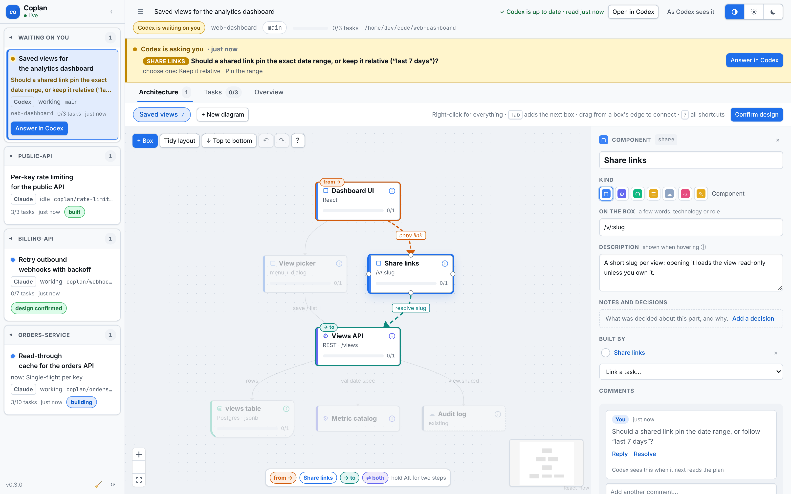
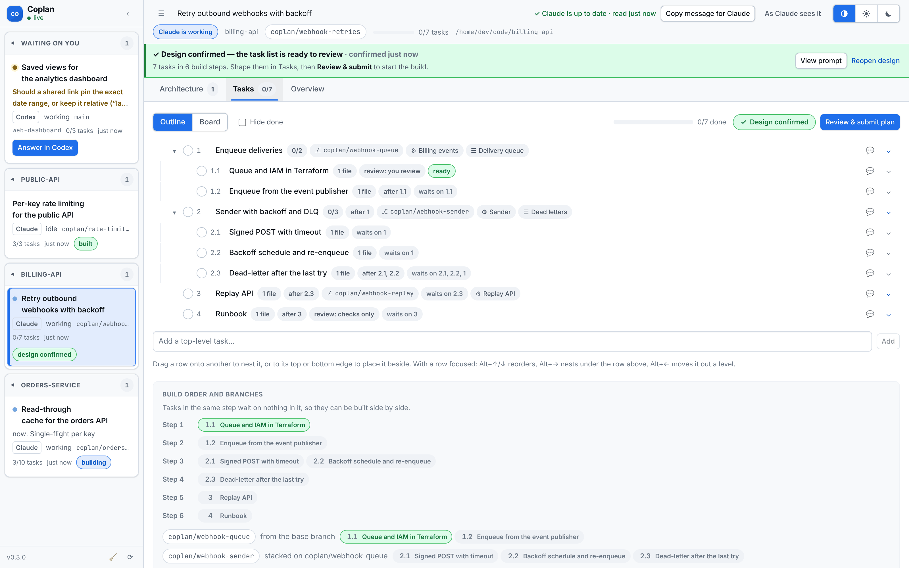
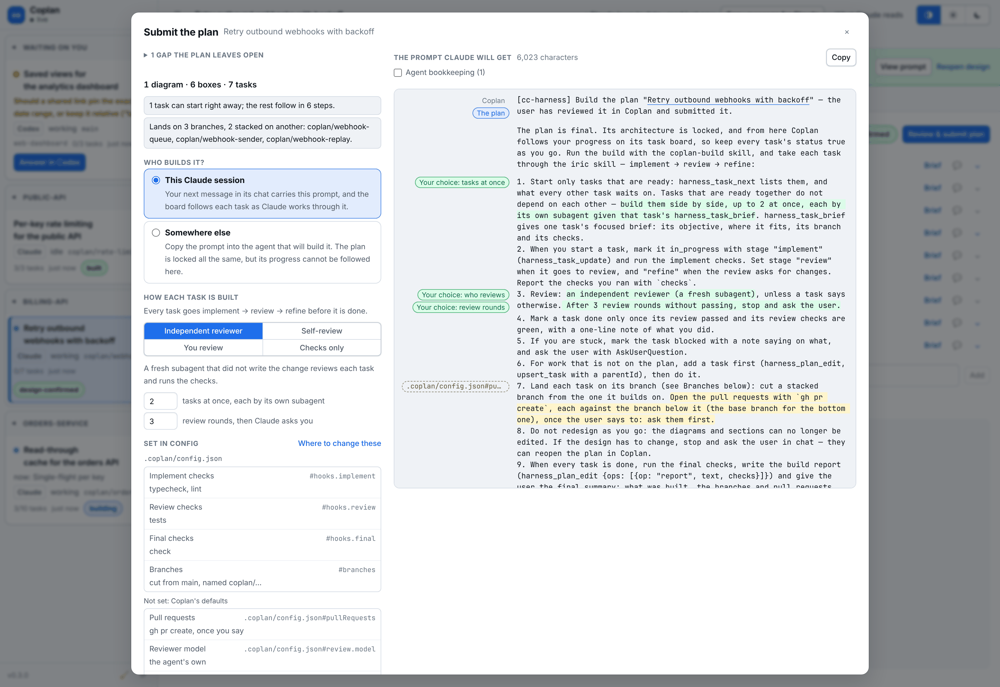
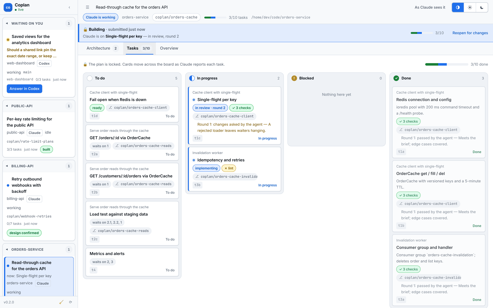
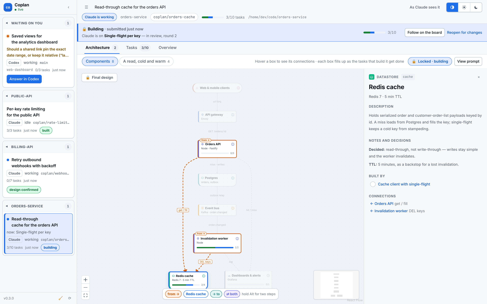
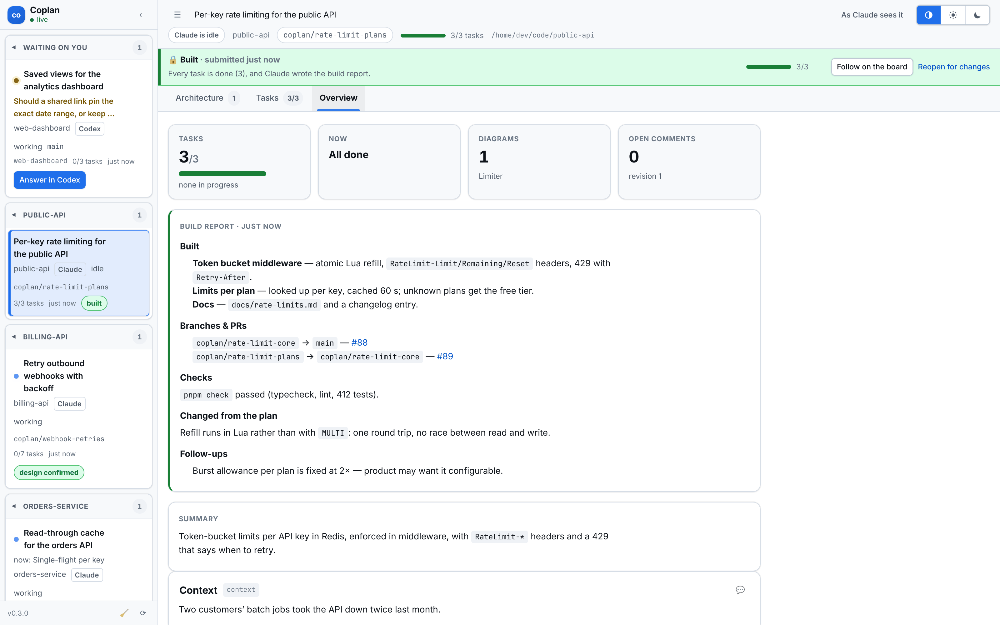
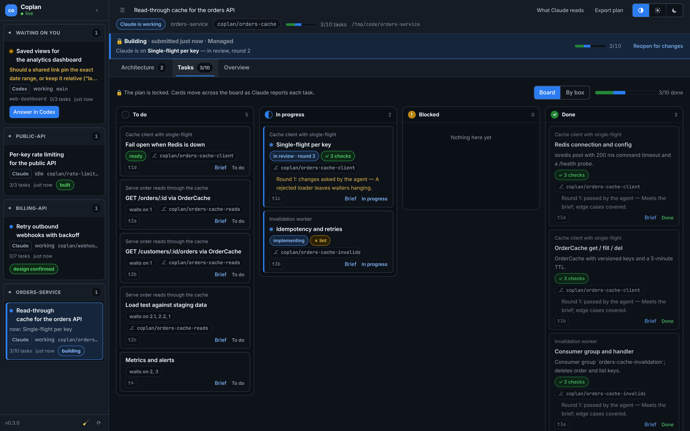

<h1 align="center">Coplan</h1>

<p align="center">
  <strong>Plan with your coding agent on a canvas, then follow the build.</strong><br />
  An open-source visual planning workspace for Claude Code, Codex and Cursor.
</p>

<p align="center">
  <a href="LICENSE"></a>
  <a href="https://github.com/bert-bae/coplan/actions/workflows/ci.yml"></a>
  
  
  
  
  <a href="CONTRIBUTING.md"></a>
</p>

<p align="center">
  <a href="docs/images/architecture.png"></a>
</p>

<p align="center">
  <a href="#see-it">See it</a> ·
  <a href="#install">Install</a> ·
  <a href="#recommended-usage">Recommended usage</a> ·
  <a href="#what-it-installs">What it installs</a> ·
  <a href="#resource-footprint">Resource footprint</a> ·
  <a href="docs/GUIDE.md">Guide</a> ·
  <a href="docs/CONFIG.md">Configuration</a>
</p>

---

Coplan gives your coding agent's plan a place to live outside the chat. The
agent — Claude Code, Codex or Cursor — publishes its design: the architecture
as diagrams, with the tasks it plans linked to the boxes they build. You
reshape it in the browser and **confirm the design**. The agent then breaks it
into a task list — focused tasks, what blocks what, which branch each lands
on — and you shape that and **submit the plan**, choosing how much of each
task's implement → review → refine cycle you keep for yourself. The plan
locks, and as the agent builds, the same page follows each task across the
board.

Coplan is free and open source under the [MIT license](LICENSE). It runs
entirely on your machine: a small local daemon, a browser UI, and one plugin
that installs in Claude Code, Codex and Cursor alike. No account, no hosted
service, and no telemetry. [What it installs](#what-it-installs) lists every
skill, tool, hook and file it adds, and [Resource footprint](#resource-footprint)
what it costs to run.

The rest of this page says "Claude" for the agent; everything works the same
in Codex and Cursor except where [Codex and Cursor](#codex-and-cursor) says
otherwise.

## See it

**1. Shape the design** (the screenshot at the top). Claude's architecture
on a canvas you can rewire, with each box's description, decisions and
comments beside it. When the agent asks you something, the page says so and
links you to its chat.

<table>
  <tr>
    <td width="50%" valign="top">
      <a href="docs/images/tasks.png"></a>
      <p><strong>2. Shape the task list.</strong> Once you confirm the design, Claude breaks it into focused tasks: what each waits on, which branch it lands on, which boxes it builds. Coplan works out the build order and how the branches stack.</p>
    </td>
    <td width="50%" valign="top">
      <a href="docs/images/submit.png"></a>
      <p><strong>3. Read the exact prompt, then submit.</strong> See every word Claude will be sent, choose who reviews each task, how many run at once and how many review rounds they get. Submitting locks the plan.</p>
    </td>
  </tr>
  <tr>
    <td width="50%" valign="top">
      <a href="docs/images/board.png"></a>
      <p><strong>4. Follow the build.</strong> Cards move across the board as Claude reports each task: which step of implement → review → refine it is on, the review round, and how its checks came out.</p>
    </td>
    <td width="50%" valign="top">
      <a href="docs/images/progress.png"></a>
      <p><strong>5. Watch the design fill in.</strong> The final diagram doubles as a progress map: each box fills up as the tasks that build it are done.</p>
    </td>
  </tr>
  <tr>
    <td width="50%" valign="top">
      <a href="docs/images/report.png"></a>
      <p><strong>6. Read the report.</strong> When every task is done, Claude runs the final checks and writes a build report: what was built, the pull requests in stack order, what changed from the plan.</p>
    </td>
    <td width="50%" valign="top">
      <a href="docs/images/board-dark.png"></a>
      <p><strong>Light or dark,</strong> following your system or your choice. One page holds every session you plan in: the rail lists them by project, with the ones waiting on you at the top.</p>
    </td>
  </tr>
</table>

The screenshots come from demo plans that [`scripts/demo/`](scripts/demo/screenshots.mjs)
seeds into a throwaway daemon, the way real hooks and tool calls would.

## Features

- **Architecture you can edit.** Claude's diagrams open laid out along their
  flow on a [React Flow](https://reactflow.dev) canvas. Add, connect, rewire
  and annotate boxes, with keyboard shortcuts, context menus and undo.
- **A task breakdown you can shape.** Nest, split and reorder tasks in an
  outline, link them to the boxes they build, and follow them on a board.
- **Design first, then tasks.** You confirm the architecture before the task
  list is made from it, so the tasks build the design you agreed to.
- **Tasks that know what blocks them.** Each task says what it waits on and
  which branch it lands on. Coplan works out what can start now, what can run
  side by side, and how branches stack into pull requests.
- **Implement → review → refine.** Every task is checked and reviewed before
  it is done: by a fresh subagent, by Claude itself, by you, or by the checks
  alone — your choice. The checks come from the repository's
  `.coplan/config.json`, so no agent guesses what to run.
- **Claude reads back what you changed.** It gets the net effect of your edits
  (what is different now, not every drag), with each diagram written out as
  an architecture.
- **Review, then sign off.** You see the exact prompt before each sign-off is
  sent, and submitting locks the plan so the design can't drift mid-build.
- **Live progress.** Cards move across the board and boxes fill up as Claude
  marks tasks in progress, done or blocked.
- **Your chat stays the chat.** Coplan never starts a turn or answers for you.
  When Claude asks a question, it links you straight back to that session.

## How it works

Coplan does one thing. It never starts a turn and never answers for you. When
Claude needs a decision it asks in its own chat. Coplan shows the question and
takes you straight to that session, in the Claude desktop app, to answer it.
What Coplan has to say to Claude (the confirmed design, the build prompt, or a
note that you changed the plan) rides along with your next message there.

```
 ┌──────── agent session: Claude Code · Codex · Cursor ─────────┐
 │  chat  ◀── you talk to and answer the agent here, only       │
 │  MCP: harness_plan_* · harness_tasks_publish · _task_*       │
 │  hooks: register the session; notice when it waits;          │
 │         note unread plan changes                             │
 └──────────────┬───────────────────────────────────────────────┘
                │ loopback HTTP
                ▼
 ┌─────────────── coplan daemon (one per user) ─────────────────┐
 │  sessions · plans · change log · static UI · SSE             │
 └──────────────┬──────────────────────────────▲────────────────┘
                │ GET /api/events (SSE)        │ POST …/plan/ops
                ▼                              │
 ┌──────────────── browser UI (React + React Flow) ─────────────┐
 │  Architecture · Tasks · Overview      ──▶ "Answer in …"      │
 └──────────────────────────────────────────────────────────────┘
```

## Install

You need Node.js 20.11 or later, [pnpm](https://pnpm.io) (or Node's
`corepack`, which provides it), `sh` and `curl`, and at least one of
[Claude Code](https://code.claude.com), [Codex](https://developers.openai.com/codex)
or [Cursor](https://cursor.com). Coplan itself can do without `git` — with
it, sessions are labelled with their repository and branch — though a build
that lands on branches needs it. The Claude desktop app is
optional; it is where *Answer in Claude* links open. Install the plugin in
each agent you use: they share one daemon and one page, and the session list
says which agent each session runs in.

It runs on **Linux and macOS**, both tested in CI. On **Windows**, run your
agent in WSL: the hooks are a POSIX shell script, and native Windows is
neither supported nor tested. From WSL, links open in your Windows browser.

### Claude Code, from GitHub

```bash
claude plugin marketplace add bert-bae/coplan
```

```bash
claude plugin install coplan@coplan --scope user
```

Or, from inside a Claude Code session, run `/plugin marketplace add
bert-bae/coplan` and then `/plugin install coplan@coplan`.

### Codex

```bash
codex plugin marketplace add bert-bae/coplan
```

```bash
codex plugin add coplan@coplan
```

Or browse for it with `/plugins` in Codex. **Then approve Coplan's hooks:**
Codex holds a plugin's hooks until you review them, so open `/hooks` in Codex
and trust the Coplan ones, then start a new session. Codex asks again after
Coplan is updated. Until they are trusted, Coplan's tools answer that no
session is registered.

### Cursor

In the editor, search for a plugin by its Git URL — paste
`https://github.com/bert-bae/coplan` into the plugin search — and install it.
From the Cursor CLI:

```bash
agent plugin marketplace add https://github.com/bert-bae/coplan
```

then install Coplan from `/plugin`. To load a clone instead, copy it to
`~/.cursor/plugins/local/coplan` and run *Developer: Reload Window*.

### Then build it

The build output (`dist/`) is not in the repository, so **build the plugin
once after installing it, and again after each update**:

- **Claude Code or Cursor:** run `/coplan-setup` in a session. It runs
  `pnpm install` in the installed plugin's directory, which builds it.
- **Codex:** ask it to *set up Coplan*. The Coplan skill tells it to run
  `pnpm install` in the plugin's folder.

Then restart the agent (or start a new session) so the plugin's MCP server
and hooks start from the build, and run `/coplan-doctor` (in Codex, ask it to
run the Coplan doctor) to check the wiring end to end. Until it is built,
Coplan's tools and hooks stay off, and `coplan` prints how to build it. The
build installs about 115 MB of build-time packages; see
[Resource footprint](#resource-footprint).

### From source

```bash
git clone https://github.com/bert-bae/coplan.git
```

```bash
cd coplan && pnpm install
```

Then load the plugin for a single Claude Code session:

```bash
claude --plugin-dir /path/to/coplan
```

Or install it permanently from your clone (for Codex, `codex plugin
marketplace add /path/to/coplan` and `codex plugin add coplan@coplan`):

```bash
claude plugin marketplace add /path/to/coplan
```

```bash
claude plugin install coplan@coplan --scope user
```

Verify the wiring against your installed CLI:

```bash
./bin/coplan doctor
```

### Removing it

1. Stop the daemon while the CLI is still there: `coplan stop`
   (`bin/coplan stop` in the plugin's folder).
2. Uninstall the plugin from your agent's plugin manager (`/plugin` in Claude
   Code and Cursor, `/plugins` in Codex). Its hooks, MCP server and skills go
   with it.
3. To delete your saved plans and Coplan's settings too, remove
   `~/.claude/cc-harness` (or wherever `CC_HARNESS_HOME` points).
   A repository's `.coplan/config.json` is yours; keep or delete it.

> **Coming from cc-harness?** Coplan was previously called cc-harness. The
> slash commands and CLI are now `/coplan*` and `coplan`; the MCP tools and
> the data directory keep their old names (`harness_plan_*`,
> `~/.claude/cc-harness`), so existing plans and configuration carry over.

## Use

In any session with the plugin enabled:

- `/coplan <task>` (in Codex, `$coplan <task>`, or just ask it to plan the
  task in Coplan): the agent investigates, then publishes a plan to the UI
- `/coplan-open`: open this session's plan in the browser
- `/coplan-setup`: build the plugin after installing or updating it
- `/coplan-init`: set up `.coplan/config.json`, the checks every task runs
- `/coplan-doctor`: check the wiring
- `/coplan-restart`: restart the daemon after a rebuild

Codex has no plugin slash commands; ask it to set up or open Coplan, run the
doctor or restart the daemon, and the Coplan skill tells it how.

`./bin/coplan status` lists every session and where its plan stands;
`./bin/coplan open` opens the UI. The UI does not open itself unless you set
`autoOpen`.

A plan goes round this loop — [the guide](docs/GUIDE.md) has every step in
detail, and everything each view can do:

1. **Claude publishes the design** (`/coplan add a cache to the orders API`)
   and asks what it needs decided, in chat.
2. **You shape it** in the browser — rewire the architecture, write decisions
   on the boxes, comment — then tell Claude in chat; it reads back the net
   effect of your edits, answers your comments, and proposes the changes that
   are yours to decide, for you to accept or reject.
3. **You confirm the design.** That locks the architecture, and your next
   message carries it to Claude.
4. **Claude makes the task list** — dependencies, branches, the boxes each
   task builds — and **you shape it**.
5. **You submit the plan,** choosing who reviews each task, how many run at
   once and how many review rounds they get. The plan locks.
6. **Claude builds it,** ready tasks first, independent ones side by side,
   each through implement → review → refine against your repository's checks,
   while the board follows along.
7. **Claude reports:** final checks, the pull requests in stack order the way
   the repository's `pullRequests` says (by default, once you say so), and a
   build report on the Overview.

## Recommended usage

### When it is worth it

Coplan pays off when there is a design to agree on before code is written:

- a change with several moving parts — new components, a data flow, a
  migration — where settling the architecture first saves a rewrite;
- work that should land as more than one pull request, or that you want
  reviewed task by task;
- a build you want to hand over and follow, rather than watch line by line.

Skip it for a one-file fix, a typo or a quick spike: ask the agent directly.
The plugin stays out of the way when you don't use it — its hooks answer in
about 20 ms and no plan is made unless you ask for one. And skip it when you
won't look at the plan: the value is the review between the agent's design
and its build.

### Before the first plan

1. **Build, then check the wiring:** `/coplan-setup`, restart the agent,
   `/coplan-doctor`.
2. **Give each repository a `.coplan/config.json` and commit it**
   (`/coplan-init` writes one from the repository's scripts and CI). Without
   it the agent picks the checks itself, once per build, and says which.
3. **Keep the `implement` checks to seconds** — typecheck, lint, format. They
   run after every implementation and refinement pass of every task. Put the
   tests in `review` and slow, repository-wide checks in `final`, and give
   language-specific checks `paths` so they only run for tasks that touch
   those files. See [CONFIG.md](docs/CONFIG.md#the-repository-coplanconfigjson).
4. **Say how pull requests are opened** in the same file
   ([`pullRequests`](docs/CONFIG.md#pullrequests)): with `gh`, Graphite or
   not at all, and whether as each branch is done, once you say (the
   default), or never. Point `template` at the repository's pull request
   template so every description follows it.
5. **Decide what must hold the build.** [`planCheck`](docs/CONFIG.md#plancheck)
   turns a gap — an undescribed box, an unanswered comment — into one that
   blocks *Confirm design* and *Submit*; [`final.blocking`](docs/CONFIG.md#final)
   keeps the plan from being built while a final check fails.
6. **Put your own defaults in `~/.claude/cc-harness/coplan.json`** — review
   mode, pull requests, standing instructions — once, instead of in every
   repository. A repository's own settings win key by key.
   See [Your own defaults](docs/CONFIG.md#your-own-defaults-coplanjson).

### While you plan

7. **Make your changes during the design.** Confirming locks the diagrams,
   sections and summary; only the title, tasks, task links and comments stay
   editable. *Reopen design* unlocks it if you must.
8. **Write decisions on the boxes,** not only in chat. A box's notes reach
   Claude with every read, and every task brief that builds that box.
9. **Comment when you are unsure** rather than editing: Claude acts on it and
   answers in the thread.
10. **Ask Claude to audit the plan, and answer its proposals.** What it finds
    that is yours to decide comes as a proposal — the change, its reason, and
    on the canvas what it adds and removes — and nothing changes until you
    accept it. Answer soon: one goes out of date once you change what it
    touches.
11. **Keep the plan the size of the change.** One diagram per idea, a few to
    about fifteen boxes each; tasks that a reviewer can judge one at a time.
    The whole plan is text the agent reads: a plan with two diagrams and ten
    tasks reads back in about 9,000 characters, one with 150 boxes and 150
    tasks in about 140,000.
12. **Answer in the agent's chat.** Coplan links you there and never answers
    for you.

### When you submit

13. **Match the reviewer to the risk.** The submit dialog sets the default;
    a task can override it.

    | Kind of task | Review | Why |
    | --- | --- | --- |
    | Most work | Independent reviewer (`subagent`) | A fresh context reads each diff against the brief. The most thorough, and the most model usage. |
    | Security-sensitive, user-facing, migrations | You (`user`) | Claude stops and asks you before the task is done. |
    | Small and low-risk | Self-review (`self`) | Claude rereads its own diff cold. |
    | Mechanical: renames, generated files, docs | Checks only (`skip`) | The review checks are the review. |

14. **Set how many tasks run at once** (`parallel`, default 2, up to 8) for
    your machine and your checks. Each one is its own subagent running its
    own checks, and a task on its own branch gets its own git worktree. Raise
    it for a large plan of independent tasks; use 1 on a laptop or when the
    test suite is heavy.
15. **Cap the review rounds** (`maxRounds`, default 3, up to 10). Past it,
    Claude stops and asks you rather than spending more on a task that keeps
    failing review.
16. **Pick the reviewer's model** with [`review.model`](docs/CONFIG.md#review),
    in the repository's config or your own `coplan.json`, if it should not be
    the agent's own: a smaller one to spend less on review, a stronger one to
    review harder.
17. **Use branches only when the change should be several pull requests.**
    Without them every task lands on the current branch.

### Day to day

18. **Leave `autoOpen` off** on shared or remote machines; open the page with
    `/coplan-open` when you want it.
19. **Don't share the page's link.** The link `coplan open` and `coplan url`
    print carries the daemon's access token (`?token=…`); the page moves it
    out of the address bar into its own storage.
20. **After updating the plugin:** `/coplan-setup`, restart the agent, then
    `/coplan-restart` so the daemon runs the new build. Open tabs reconnect.
21. **Now and then:** `coplan clean --dry-run` lists what could go — finished
    sessions, interrupted writes, the older part of the log.

### Trust

- **Read a repository's `.coplan/config.json` like its `package.json`
  scripts.** The commands in it are handed to the agent to run as each task's
  checks, and its `instructions` — text, or files in the repository they
  name — are added to what the agent is told when it plans, builds and
  reviews. Coplan never runs the commands itself, and the agent runs them
  under your permission settings — so in a repository you don't trust, read
  that file (and any instruction files it names) before you build, and keep
  permission prompts on.
- **The skills direct the agent; they grant it nothing.** Everything a build
  does to your repository — branches, commits, pushes, pull requests — is the
  agent acting under its normal permissions. See [Skills](#skills).
- **Everything stays on your machine.** See
  [What it reads, writes and connects to](#what-it-reads-writes-and-connects-to).

## What it installs

One plugin, in this repository, with a manifest per agent:
[`.claude-plugin/`](.claude-plugin/plugin.json),
[`.codex-plugin/`](.codex-plugin/plugin.json) and
[`.cursor-plugin/`](.cursor-plugin/plugin.json). Nothing is downloaded at run
time; the one-time build fetches its packages from the npm registry with pnpm.

| Part | What it is | Runs as | Lifetime |
| --- | --- | --- | --- |
| [MCP server](#the-mcp-server-harness) `harness` | Ten tools the agent calls to publish, read, propose changes to and track the plan | `node dist/mcp/main.js`, over stdio | One per agent session, started by the agent |
| [Hooks](#hooks) | Seven lifecycle hooks in Claude Code and Codex, five in Cursor | `bin/coplan-hook-relay.sh` — `sh` and `curl` | About 20 ms per event |
| [Daemon](#what-it-reads-writes-and-connects-to) | Local server: keeps the plans, serves the page | `node dist/daemon/main.js` | One per user. The first hook starts it; it exits after two idle hours |
| [Skills](#skills) | `coplan`, `coplan-build`, `iric` | Instructions the agent loads | When the agent uses one |
| [Slash commands](#slash-commands-and-the-cli) | `/coplan-setup`, `-open`, `-init`, `-doctor`, `-restart` | Each runs `bin/coplan` | When you type one |
| [CLI](#slash-commands-and-the-cli) | `coplan` | `bin/coplan` | When you run it |
| Browser page | React and React Flow, served by the daemon | A tab | While you have it open |

The daemon, the MCP server and the CLI have **no runtime dependencies** —
only Node's standard library. The page's React and React Flow are compiled
into its bundle at build time.

### Skills

Plain Markdown in [`skills/`](skills/). The agent always sees each skill's
one-paragraph description (400–500 characters) and loads the body only when
it uses the skill.

| Skill | The agent uses it when | It tells the agent to | So the agent may |
| --- | --- | --- | --- |
| [`coplan`](skills/coplan/SKILL.md) (12 KB) | you type `/coplan` or `$coplan`, ask to plan something in Coplan or to set Coplan up, or a confirmed design arrives | investigate the code, publish the design, read your edits back and answer your comments, propose changes that are yours to decide rather than make them, then break the confirmed design into a task list — and not build until you submit | call Coplan's tools; ask you questions in chat; propose edits for you to accept or reject; run `pnpm install` in the plugin's folder when you ask it to set Coplan up |
| [`coplan-build`](skills/coplan-build/SKILL.md) (8 KB) | a submitted plan's build prompt arrives, or you ask it to build a Coplan plan | start only tasks that are ready, build independent ones in parallel, land each on its branch, then run the final checks and write the report | start up to `parallel` subagents; create branches and git worktrees; commit once per task; rebase stacked branches; run the repository's checks; push the branches; open pull requests with `gh` or Graphite, as the repository's [`pullRequests`](docs/CONFIG.md#pullrequests) says — by default only once you say so — written from its pull request template if it has one |
| [`iric`](skills/iric/SKILL.md) (6 KB) | building each task, or when you ask to run a task through iric | implement inside the task's scope, run the checks, have it reviewed the way you chose, refine until it passes or the round limit, and report each step | run the `implement` and `review` checks; start a reviewer subagent (review `subagent`), on the model [`review.model`](docs/CONFIG.md#review) names if one is set; stop and ask you (review `user`, or past `maxRounds`) |

### The MCP server: `harness`

A stdio server (MCP protocol `2024-11-05`), hand-written with no
dependencies. Each tool call is forwarded over loopback HTTP to the daemon —
starting one if none is running — and the daemon's text comes back as the
result, within 30 seconds. **None of the tools write to your repository, run
a command or reach the network beyond `127.0.0.1`:** they read and change the
plan the daemon holds — reading, from the repository, only its Coplan config
and the files that names — and none of them waits on you. In Claude Code
they are named `mcp__plugin_coplan_harness__<tool>`.

| Agent | Declared in | Command | Environment | Timeouts |
| --- | --- | --- | --- | --- |
| Claude Code | [`.mcp.json`](.mcp.json) | `node ${CLAUDE_PLUGIN_ROOT}/dist/mcp/main.js` | `CC_HARNESS_PLUGIN_ROOT` | 60 s per call |
| Codex | [`mcp/codex.json`](mcp/codex.json) | `node ./dist/mcp/main.js`, from the plugin's folder | `COPLAN_AGENT=codex`; passes `CC_HARNESS_HOME` on | 20 s to start, 60 s per call |
| Cursor | [`mcp/cursor.json`](mcp/cursor.json) | `node ${CURSOR_PLUGIN_ROOT}/dist/mcp/main.js` | `COPLAN_AGENT=cursor`, `COPLAN_WORKSPACE=${workspaceFolder}` | Cursor's defaults |

The ten tools:

| Tool | Changes the plan? | What it does |
| --- | --- | --- |
| `harness_plan_publish` | Yes | Publish the whole plan. Items keep their comments, positions and statuses when their ids survive; refused while you have changes Claude hasn't read, so it can never overwrite your edits blind, and once you confirm the design (the task list then comes from `harness_tasks_publish`). |
| `harness_plan_read` | No — marks your edits as read | The plan as text, leading with the net effect of your changes since the last read, with every id Claude needs. Diagrams read as an architecture: the system's shape, each part in flow order with its description, decisions and tasks, then every connection. `changes_only` skips the document and quotes edited text instead. |
| `harness_plan_check` | No | What the plan leaves open: boxes no task builds, tasks that build no box, undescribed boxes, tasks with no detail, box ids two diagrams share, branch layouts a stack of pull requests cannot follow, and your comments nobody answered. The same list shows in the sign-off dialogs. |
| `harness_plan_edit` | Yes | A batch of targeted edits — sections, diagrams, one box or arrow at a time, tasks, moves, comments (on the plan, an item, or one box or arrow) and replies, the build report — applied all or nothing. Once the design is confirmed, only tasks, task links and comments; once the plan is submitted, only task edits, comments and the report. |
| `harness_plan_propose` | Not until you accept it | Suggest a change instead of making it: a batch of edits, with Claude's reason, that waits for you. You see it beside what it changes — and on the canvas, what it adds, changes and removes — and accept it (the edits apply, as yours) or reject it, saying why if you like. Claude hears your answer the next time it reads. A proposal you have moved past goes out of date and cannot be accepted. |
| `harness_tasks_publish` | Yes | Publish the task list for the confirmed design: replaces the task tree and nothing else, with dependencies, branches, review modes and the boxes each task builds. |
| `harness_task_next` | No | What can be built now: ready tasks, how many to run at once, what is in progress and at which step, what the rest wait on, the branches — and, once every task is done, how to finish. |
| `harness_task_brief` | No | One task's focused brief, written to hand to a subagent as is: objective, the boxes it builds and their connections, what it comes after and before, its scope, branch, and its implement → review → refine cycle with the exact checks. |
| `harness_task_update` | Yes — progress only | Mark a task in progress, done, blocked or dropped, with a one-line note, and report its step of the cycle, the checks run and the review's verdict. Refuses to start a task that still waits on another, or to finish one without a passing verdict (yours, for a task you review) or whose checks failed. |
| `harness_branch_update` | Yes — branch records only | Record a branch's pull request and where it stands, so the board shows the stack — and says what to restack when a branch below merges. |

### Hooks

Every hook runs [`bin/coplan-hook-relay.sh`](bin/coplan-hook-relay.sh)
`<event> <agent>`: a POSIX `sh` script that posts the event to the daemon on
`127.0.0.1` with `curl` and prints the daemon's answer. It was written so a
hook costs no Node start-up and can never get in your way:

- **It never blocks or holds a turn.** It never returns a decision that stops
  the agent, and when the daemon is down, slow or answers garbage it prints
  nothing and exits 0 — `curl` gives up after 4 seconds (10 at session start).
- **It starts the daemon only on a session's start or your message,** waiting
  up to 5 seconds; other events with no daemon simply do nothing.
- **It keeps the token off the command line,** reading it from a file only you
  can read rather than passing it where other local users could see it.

Claude Code's hooks ([`hooks/hooks.json`](hooks/hooks.json)):

| Event | Matches | Timeout | What Coplan does with it |
| --- | --- | --- | --- |
| `SessionStart` | — | 20 s | Registers the session and labels it with its repository and branch (`git rev-parse`, read-only). If the plugin isn't built, says so once. |
| `UserPromptSubmit` | — | 10 s | Clears a pending question, and lists the session on the page once your message starts with `/coplan`. Adds to your message the design or build prompt you signed off, once; or, if you changed the plan since Claude last read it, one line saying so ([`promptNotice`](docs/CONFIG.md)). |
| `PreToolUse` | `AskUserQuestion` | 5 s | Shows the question on the page and moves the session to *Waiting on you*. |
| `PostToolUse` | every tool | 5 s | Clears a question or permission prompt once a tool finishes, and lists the session once the agent loads a Coplan skill. A payload over 256 KB is cut to the session id before it is sent. |
| `Notification` | — | 5 s | Notices permission and idle prompts. |
| `Stop` | — | 5 s | Marks the turn finished; if Claude's reply ends on a question, shows it. |
| `SessionEnd` | — | 5 s | Marks the session ended. |

Codex's ([`hooks/codex.json`](hooks/codex.json)) are the same events, except
that `PreToolUse` matches `request_user_input` and `request_user_input_async`,
and `PermissionRequest` takes the place of `Notification`. Cursor's five
([`hooks/cursor.json`](hooks/cursor.json)) are its own: `sessionStart`,
`beforeSubmitPrompt`, `afterAgentResponse`, `stop` and `sessionEnd` — its
hooks see neither its question tool nor permission prompts, so a question
is noticed when a turn ends on one.

**What a hook sends, and what is kept.** A hook sends the event as the agent
hands it over — for `UserPromptSubmit` that includes your message, for
`PostToolUse` the tool's input and output — and four variables that say where
the session runs, so *Answer in Claude* can link back to it:
`CLAUDE_CODE_REMOTE_SESSION_ID`, `CLAUDE_CODE_REMOTE_SDK_URL`,
`CLAUDE_CODE_BRIDGE_SESSION_ID` and `CLAUDE_CODE_ENTRYPOINT`. It goes to
`127.0.0.1` only. The daemon keeps the session's id, folder, repository,
branch, agent and status, when it first used Coplan, and the question it is
waiting on — up to six questions with their options, each cut to 300
characters, or the last paragraph of a reply that ends on a question. Your
messages and tool output are looked at — a message for whether it starts with
`/coplan` (or holds `$coplan`), a tool for whether it loaded a Coplan skill —
and dropped; they are never written to disk. Every session in an agent with
the plugin registers, but only one that has used Coplan is listed on the page.

### Slash commands and the CLI

Each slash command is a short Markdown prompt in [`commands/`](commands/)
that has the agent run the CLI:

| Command | Runs | For |
| --- | --- | --- |
| `/coplan-setup` | `pnpm install --frozen-lockfile` in the plugin's folder (with corepack's pnpm if pnpm is missing), then `coplan version` | Building after an install or update |
| `/coplan-open` | `coplan open` | Opening this session's plan |
| `/coplan-init` | `coplan init --print`; the agent checks it against your CI and scripts, asks before replacing an existing file, writes `.coplan/config.json` and reads it back with `coplan check implement --list` | Setting up a repository's checks |
| `/coplan-doctor` | `coplan doctor` | Checking Node and curl, both configs and the repository's, the daemon's version, and the whole round trip with real hook payloads. Its test sessions are deleted afterwards |
| `/coplan-restart` | `coplan restart` | Running a new build; open tabs reconnect |

`/coplan <task>` is the `coplan` skill itself. The CLI, `bin/coplan` in the
plugin's folder:

| `coplan …` | Does |
| --- | --- |
| `start`, `stop`, `restart` | Start the daemon (if none is running), stop it, or replace it with the current build at the same address |
| `status` | The daemon and every registered session |
| `open [id]`, `url [id]` | Open the page, or print its link with the access token |
| `logs` | Follow the daemon's log |
| `doctor` | Check the wiring end to end |
| `check [implement\|review\|final]` | Run a stage of the repository's checks and print only what failed (`--files`, `--list`, `--json`) |
| `init` | Write a starting `.coplan/config.json` from the repository's scripts (`--print` to only show it, `--force` to replace one) |
| `clean` | Remove stale files (`--dry-run` to only list them) |
| `version` | Print the version |

### What it reads, writes and connects to

**On disk.**

| Where | What | Written by |
| --- | --- | --- |
| `~/.claude/cc-harness/` (or `CC_HARNESS_HOME`), a directory only you can read | `daemon.json` (the daemon's address, pid and token), `auth.header` (the token, for the hook relay), `daemon.log`, `sessions/<id>/state.json` (each plan with its change log and sign-offs), and `start-failed`, a marker after a daemon that would not start. Also yours, if you make them: `config.json` (Coplan's settings), `coplan.json` (your defaults for every repository's build) and `instructions/<point>.md` (your standing instructions) | The daemon; you |
| The plugin's folder | `node_modules/` and `dist/` | The one-time build |
| Your repository | Nothing. Coplan reads `.coplan/config.json`, `.claude/harness.json`, and the instruction files and pull request template the config names — only files inside the repository, a link that leads outside it is refused. `coplan init` writes `.coplan/config.json` when you ask it to | — |

The agent changes your repository as it builds, of course — with its own
permissions, as it would without Coplan.

**Processes.** The daemon, started detached by a hook, the MCP server or the
CLI. `git rev-parse`, read-only, when a session starts. Your browser, only
when you ask (`coplan open`, `/coplan-open`, or `autoOpen`), and the agent's
desktop app on *Answer in …* or with `openClaudeOnQuestion` on. Your
repository's checks only ever run when the agent, or you, runs them.

**Network.**

- The daemon listens on `127.0.0.1` only, on a port the system picks, and
  keeps that port when you restart it.
- Every API call needs its 48-character random token. The page keeps it out
  of cookies, and its live stream uses single-use tickets instead.
- A request with any Host but `127.0.0.1` or `localhost` is refused, against
  DNS rebinding, and so is a write from another origin.
- Nothing goes out: no telemetry, no update check, no account, and the page
  loads nothing from the internet — no CDN, no web fonts. In a measured
  session the page made requests to `127.0.0.1` and nowhere else.
- The links you click leave, of course: *Answer in Claude* to claude.ai or the
  desktop app, and the pull request links in a build report.

## Codex and Cursor

The plugin, the daemon and the page are the same for every agent. What
differs is what each agent lets a plugin see and do:

| | Claude Code | Codex | Cursor |
| --- | --- | --- | --- |
| Hooks | run once installed | run once you trust them in `/hooks` | run once installed |
| Start a plan | `/coplan <task>` | `$coplan <task>`, or ask | `/coplan <task>` |
| The build prompt reaches the agent | with your next message ("go") | with your next message ("go") | you paste it — submitting copies it — or say "build the plan" and it reads it with `harness_plan_read` |
| "You changed the plan" note on your next message | yes | yes | where Cursor passes it on |
| A question is noticed | `AskUserQuestion`, permission prompts, idle prompts, a turn ending on a question | `request_user_input` (Plan mode), permission requests, a turn ending on a question; Codex has no hook for idle prompts | a turn ending on a question: Cursor's hooks see neither `AskQuestion` nor permission prompts |
| *Answer in …* opens the session | cloud and Remote Control sessions | the Codex app (`codex://threads/…`) | no link: Cursor has none for a chat |
| Slash commands | `/coplan-setup`, `/coplan-open`, `/coplan-doctor`, `/coplan-restart`, `/coplan-init` | none; ask, and the skill runs `coplan` | `/coplan-setup`, `/coplan-open`, `/coplan-doctor`, `/coplan-restart`, `/coplan-init` |

How each one is wired:

- **Codex** reads `.codex-plugin/plugin.json`, which points at
  `hooks/codex.json` and `mcp/codex.json`. Codex's hooks use Claude Code's
  event names, and its MCP server learns which thread is calling from each
  tool call. Codex offers `request_user_input` only in Plan mode; elsewhere
  it asks in plain chat, which Coplan notices when the turn ends on the
  question.
- **Cursor** reads `.cursor-plugin/plugin.json`, which points at
  `hooks/cursor.json` (Cursor's own hook format) and `mcp/cursor.json`.
  Cursor starts one MCP server per window rather than per chat, so the tools
  act on the chat in that workspace that was active last. Cursor's hooks
  cannot reliably add to a prompt, so the build prompt is pasted or read
  instead, and its hooks do not see `AskQuestion`. If Cursor's *third-party
  configs* setting imports the Claude Code plugin as well, Coplan recognises
  Cursor's payloads and files them under Cursor all the same.

## Resource footprint

Coplan itself is small: one mostly idle Node process for every user, one
for every agent session, and a `curl` per hook. The real cost of a Coplan
build is the agent's — the model passes and the checks it runs — and the
settings you choose when you submit decide how much. Both are below, measured
as described [at the end of this section](#how-these-were-measured).

### On your machine

| Process | How many | Memory (RSS) | CPU | Lives |
| --- | --- | --- | --- | --- |
| Daemon | One per user | 56 MB with no plans; 63–71 MB with four; 98 MB after a 150-box, 150-task plan took 500 edits | Idle: under 0.02% of one core. An edit takes about 6 ms | Starts in about 90 ms. Exits after `idleShutdownMinutes` (120) with no session active and no tab open; the next hook starts it again |
| MCP server | One per agent session | About 68 MB (a bare `node` is 43 MB on the same machine) | Idle between calls; a call takes 5–50 ms | As long as its session |
| Hook relay | One per event | `sh` and `curl` | About 20–28 ms per event; 7 ms when no daemon is running | Milliseconds |
| Browser tab | Only if you open one | 10 MB of JavaScript heap; 830 KB loaded per page load | See below | While open |

So three agent sessions at once come to roughly 270 MB, and the CPU cost of
an idle Coplan is close to nothing. The daemon's only timers are a lock check
every 5 seconds, an idle check every minute, a sweep every 5 minutes, and a
keep-alive every 25 seconds for each open tab.

**The tab.** While a session in the list is working, its status dots
animate. In headless Chromium, with software rendering, that kept an
otherwise idle tab's main thread about 6% busy; with reduced motion on (your
system's setting), 0.3%. Browsers don't animate background tabs, so a tab
you aren't looking at costs next to nothing.

### On disk

| What | Size | Kept |
| --- | --- | --- |
| Build-time packages (React, React Flow, Tailwind, esbuild, TypeScript, jsdom for the tests) | About 115 MB in pnpm's store, linked into the plugin's `node_modules` | Until you remove the plugin |
| `dist/` | 15 MB: 5 MB to run (the page is 3.6 MB of it, 2.9 MB of that a source map) and 9.6 MB of compiled tests | Rebuilt on each `/coplan-setup` |
| One plan | 13–55 KB for the demo plans above; 520 KB for 150 boxes and 150 tasks after 500 edits | 30 days after its last change; at most 60 sessions in memory |
| `daemon.log` | Trimmed to its newest 256 KB once past 1 MB | — |

The build took 3–4 seconds here, with a warm or an empty pnpm store, on a
fast connection; elsewhere it is mostly download time.

### In the agent's context

Everything Coplan hands the agent is text in its context window, and so
counts against the model's tokens.

| What | Size | When |
| --- | --- | --- |
| The ten tool definitions | About 32 KB of JSON schema — on the order of 8,000–10,000 tokens | Whenever the agent loads the server's tools |
| The three skill descriptions | About 1.3 KB | Always listed |
| A skill's body | 12.3 KB (`coplan`), 8.1 KB (`coplan-build`), 6.5 KB (`iric`) | When the agent uses that skill |
| The plan, read back | About 9,000 characters for two diagrams and ten tasks; about 140,000 for 150 boxes and 150 tasks | Each `harness_plan_read` (`changes_only` is shorter), and each publish's reply |
| A sign-off prompt | About 6,000 characters for a seven-task plan; a hook adds at most about 10,000, and a longer plan is handed over as its summary and task list | Once per sign-off |
| "You changed the plan" | One line | Your next message after you edit |

### The build

Coplan never runs a model or a check; the agent does, and the submit dialog
decides how much:

- **Every task** gets one implementation pass, then review — and, until the
  review passes, a refinement and another review — up to `maxRounds`
  (default 3) reviews.
- **Who reviews:** an independent reviewer is a fresh subagent for every
  review round, reading the brief and the diff; self-review is a reread by the
  agent that built it; you cost your time; checks only costs no model at all.
  `review.model` runs the independent reviewer on a model of your choosing.
- **How many at once:** `parallel` (default 2, up to 8) subagents at a time,
  each running its own checks, and a git worktree — a whole checkout on
  disk — for each task on a branch of its own.
- **The checks** are your repository's: `implement` after every pass,
  `review` every round, `final` once. Their CPU and time are whatever your
  commands take.

With subagent review, a plan of *n* tasks that each pass after *r* reviews
takes about *n* × (2*r*) subagent passes — an implementation and, per round,
a review and (after a failed one) a refinement — plus the orchestrating
agent's own work. Ten tasks that all pass first time: about 20 passes. Ten
that each use all three rounds: about 60.

### How these were measured

On Linux x86-64 (4 vCPUs, Xeon at 2.1 GHz, 16 GB), Node.js 22.23, curl 8.5,
Coplan 0.3.0, with the demo plans the screenshots show. Memory is RSS from
`/proc`; CPU is the daemon's user and system time over 60 idle seconds; a
hook's latency is the average of 50 runs through the real relay script; the
MCP server was started and called as an agent would; the tab was measured in
headless Chromium with Playwright and the DevTools performance metrics; sizes
in the context are byte and character counts. Your numbers will differ with
your machine and your plans, but not by an order of magnitude.

## Troubleshooting

`coplan doctor` (or `/coplan-doctor`) checks the wiring end to end: the
plugin's files, the daemon, each agent's hooks and the MCP server. It says
what failed and what to do. Some things it cannot see:

- **Codex: Coplan's tools say "No session is registered yet".** Codex runs a
  plugin's hooks only after you trust them, and asks again after every
  Coplan update: `/hooks` then lists them as *New hook - review required* or
  *Modified since last trusted - review required*. Until then they do not
  run, so no session reaches Coplan. Open `/hooks` in Codex, trust the
  Coplan hooks, and start a new session. The doctor cannot detect this:
  Codex keeps that state internally (a hash of its own making in
  `~/.codex/config.toml`), and the doctor tests the hooks by calling them
  itself.
- **A setting that does nothing.** An error in `~/.claude/cc-harness/config.json`
  or `.claude/harness.json` is shown in the page of each session that reads
  it (a toast, and **⚠ settings** in the rail's footer until you fix it), in `coplan doctor` and in
  `~/.claude/cc-harness/daemon.log`. One in `.coplan/config.json` is shown in
  the prompts, the review dialogs, `coplan check` and the doctor. Each says
  what is used instead.

## Configuration

`~/.claude/cc-harness/config.json`, overridden per repo by
`.claude/harness.json` — for every agent, Codex and Cursor included. The
build's checks and defaults live in the repository's `.coplan/config.json`.
See [docs/CONFIG.md](docs/CONFIG.md).

## Contributing

Bug reports, ideas and pull requests are welcome. [CONTRIBUTING.md](CONTRIBUTING.md)
covers setting up a checkout, the checks CI runs, and how the code is laid
out. The short version:

```bash
pnpm install           # installs, and builds dist/
```

```bash
pnpm check             # typecheck, build and test
```

`dist/` is build output and is not committed; `pnpm install` builds it.

A release is a version bump — `package.json` and the three plugin
manifests, kept equal by a test — with a `## <version>` section in
CHANGELOG.md. When it reaches `main`, CI tags it `v<version>` and publishes
that section as the release notes.

## License

[MIT](LICENSE) © Elbert B.
