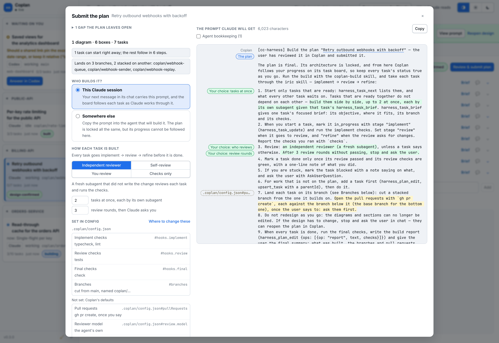
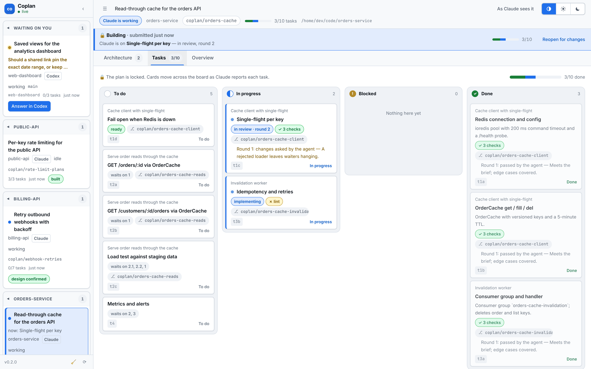
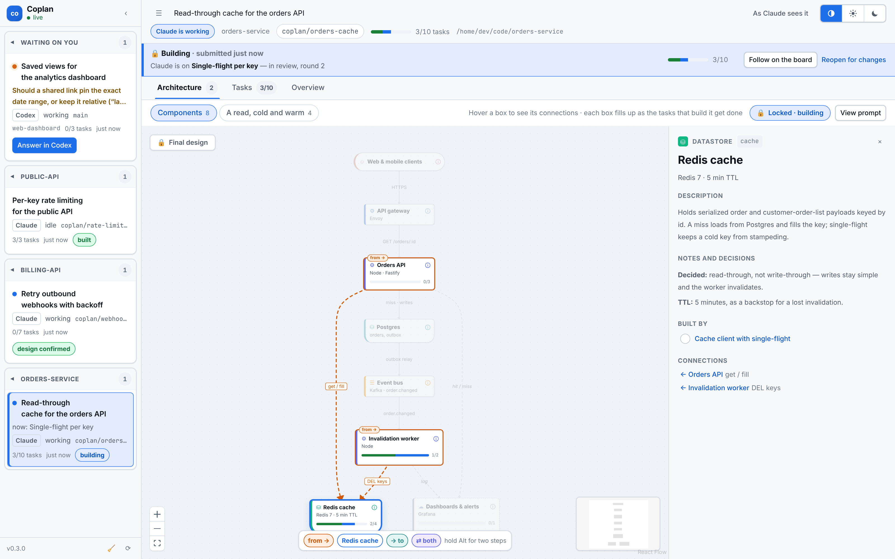
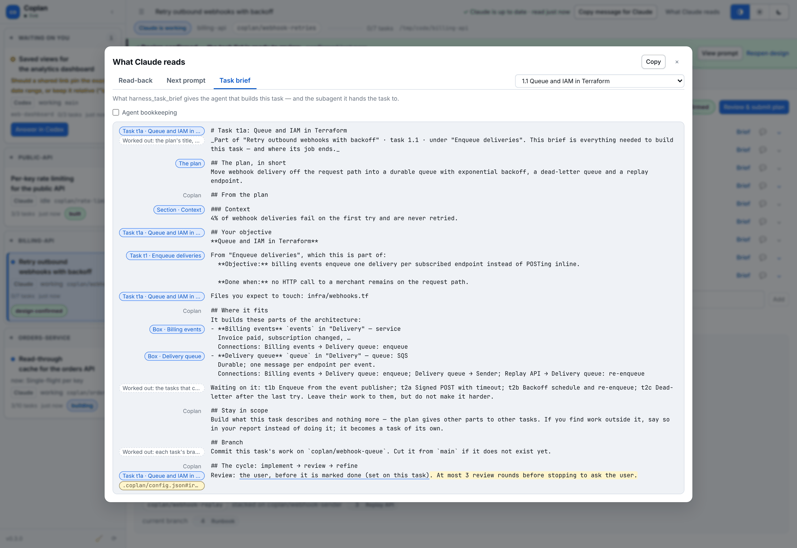

# Using Coplan

The whole loop in detail: what happens at each step, what the two sign-offs
lock — and how to give either in chat — how checks and questions work, and
everything the views can do. The
[README](../README.md) has the overview, what Coplan installs, and what it
costs to run; [CONFIG.md](CONFIG.md) has every setting.

This page says "Claude" for the agent; everything works the same in Codex
and Cursor except where the README's
[Codex and Cursor](../README.md#codex-and-cursor) table says otherwise.

- [The loop](#the-loop)
- [Confirming the design](#confirming-the-design)
- [Submitting the plan](#submitting-the-plan)
- [Going ahead from chat](#going-ahead-from-chat)
- [Where a plan stands: four statuses](#where-a-plan-stands-four-statuses)
- [Requesting revisions](#requesting-revisions)
- [Checks: `.coplan/config.json`](#checks-coplanconfigjson)
- [Questions are answered in Claude](#questions-are-answered-in-claude) — and
  [when Claude asks](#when-claude-asks)
- [The views](#the-views)
- [Exporting the plan](#exporting-the-plan)
- [Housekeeping](#housekeeping)

## The loop

1. **Claude publishes the design.** `/coplan add a cache to the orders API`
   — Claude reads the code and calls `harness_plan_publish` with the
   architecture and the tasks it plans. It decides what the code and your
   request leave open and writes each decision on the box it is about, for
   you to change; it asks you, with `AskUserQuestion` in chat, only what it
   must (see [When Claude asks](#when-claude-asks)).
2. **You shape the plan.** In the browser, rearrange and rewire the
   architecture, write down the decisions on each box, add the tasks each box
   needs from the box itself, drag tasks into the order you want, nest and
   split them, and comment on anything. Every edit is
   saved at once and recorded in the plan's change log as yours.
3. **You hand it back in chat.** The header says when Claude hasn't read
   your changes and opens the session in Claude. If you just type in chat,
   the next prompt carries a one-line note saying where the plan changed. Or
   send your comments as one ask: **Request revisions**
   ([below](#requesting-revisions)).
4. **Claude reads it back.** `harness_plan_read` leads with the net effect of
   your edits since it last looked — what is different now, not each step
   you took, and never where you dragged boxes — then the plan, with each
   diagram written out as an architecture. It adjusts and replies in your
   comment threads.
5. **You confirm the design.** *Confirm design* shows exactly what Claude
   will be asked, and confirming locks the architecture, sections and
   summary. Or tell Claude in chat — "make the task list" — and it confirms
   it for you ([Going ahead from chat](#going-ahead-from-chat)). Confirming
   is optional: *Submit plan*, or "build it" in chat, goes straight to step 8
   and builds the tasks planned on the diagram.
6. **Claude makes the task list.** Your next message carries the design.
   Claude breaks the planned tasks into focused ones, links them by what
   blocks what, names the boxes each builds and the branch each lands on,
   and publishes them with `harness_tasks_publish`. You shape that list —
   dependencies, branches and review modes are editable on each task — and
   the Tasks view shows the build order it implies.
7. **You submit it** — in Coplan or in chat. *Review & submit plan* shows
   the exact build prompt and asks how the plan is built — *Tracked*,
   *Managed* (with who reviews each task, how many run at once, how many
   review rounds before Claude asks you) or *Export* — and submitting locks
   the plan. Or tell Claude in chat — "looks good, build it" — and it submits
   it for you, the way you last chose in that dialog. To take the plan
   elsewhere without submitting anything, *Export plan* in the header copies
   it as Markdown at any point.
8. **Claude builds against it.** Your next message in Claude carries the
   prompt — or, submitted from chat, Claude has it already. Claude starts only tasks that are ready and reports each one;
   in a Managed build it takes each through implement → review → refine,
   running the repository's checks. Cards move across the board, showing
   each task's step and checks; boxes fill up as their tasks finish.
9. **Claude reports.** Once every task is done it runs the final checks,
   opens the pull requests in stack order if you want them, and writes a
   build report that appears on the Overview.

## Confirming the design

When the architecture is right, **Confirm design** (top right of the
Architecture view) shows what Claude will be asked — break this design into
a task list — with the design itself and anything you add. Beside it, *Set
in config* lists what the ask takes from config: the checks for each stage,
the review mode tasks get by default, how branches are cut and named, and
your standing instructions for this step, each with the file and key that
set it (see [Where the settings come from](#where-the-settings-come-from)).
Confirming locks the diagrams, sections and summary; the
title, the tasks, which boxes they link to, and comments still change — a
box's task list still adds, renames and unlinks them. Your
next message in Claude carries it, once — in Cursor, confirming copies it for
you to paste, or the agent's next `harness_plan_read` picks it up. *Reopen
design* unlocks it again.

Confirming is a checkpoint you may skip. *Submit plan*, beside *Confirm
design*, opens the Submit dialog straight from the design, and the build
then follows the tasks planned on the diagram.

Claude answers with the task list. Each task can say:

| Field | What it means |
| --- | --- |
| Starts after (`dependsOn`) | Tasks that must be done first. A parent's apply to all its subtasks, and depending on a parent means waiting for all of it. Loops are refused. Anything without one can run alongside the rest. |
| Branch | Where the work lands; subtasks inherit it. A branch whose tasks build on another branch's is *stacked* on it. No branch means the session's current branch. |
| Review | `subagent`, `self`, `user` or `skip`, when a task needs other than the build's default. |
| Builds (`builds`) | The boxes it implements, so the diagram tracks it. |

The Tasks view marks each task *ready* or what it *waits on*, and shows the
**build order** — steps of tasks that can be built side by side — and how
the branches stack.

## Submitting the plan

When the tasks are right, **Review & submit plan** (on the Architecture and
Tasks views) opens the review:

<a href="images/submit.png"></a>

- **The prompt**, exactly as Claude will get it: what to do, how to report
  progress, anything you add for Claude, what you changed that Claude has not
  read yet, then the whole plan — summary, sections, the architecture and
  the task tree. It is rebuilt as you type, and *Submit* waits until what is
  on screen is what will be sent; a plan that moved on since is refused.
- **How it is built.** The mode starts from the repository's
  [`mode`](CONFIG.md#mode): Managed where its `.coplan/config.json` sets
  `iric`, else Tracked.
  - *Tracked*: Claude builds it its own way. Your next message in its chat —
    "go" will do — carries the prompt, once, and the board follows each task
    as Claude reports it. The prompt has no implement → review → refine:
    how each task is built and checked is Claude's call, and nothing it
    reports is refused. Where a Managed build would have held a task back —
    done before any review, a failing check, past the round or parallel
    limit, dropping work you signed off — Claude's reply carries a note
    saying so instead.
  - *Managed*: the same hand-over, and every task goes implement → review →
    refine. You choose who reviews — an *independent reviewer* (a fresh
    subagent), *self-review*, *you* (Claude stops after each task and asks),
    or *checks only* — how many ready tasks are built at once, and how many
    review rounds a task gets before another is yours to allow. The defaults
    come from the repository's `iric` — or, where it has none, self-review,
    one task at a time and three rounds, which assume nothing about the
    agent.
  - *Export*: the whole plan as Markdown — summary, sections, diagrams, the
    tasks and their briefs — with no build instructions, review modes or
    Coplan tool names, copied for you to paste anywhere. This version is
    locked here, but nothing reports back, so nothing moves.
- **Set in config.** What the prompt takes from config, read-only: the mode
  it starts from, the checks for each stage, branches, how pull requests are
  opened, the reviewer model, whether failing final checks hold the report,
  and your standing instructions for the build.

### Where the settings come from

Both dialogs group these settings by the file that sets them —
`.coplan/config.json` in the repository, or your own `coplan.json` and
`instructions/<point>.md` in Coplan's home — and give each its key
(`#pullRequests`, `#review.model`); standing instructions name every file
that adds to them, yours first. A setting no file sets is listed under
*Not set: Coplan's defaults*. They are read-only here, because the
repository's file is committed and shared with your team: change them in
the file, and the preview follows at once. Each key links to what it does in
[CONFIG.md](CONFIG.md).

A prompt too long for one message (about 9,000 characters) keeps the
instructions, what you wrote and changed, the summary and the task list, and
the dialog says what it leaves out — the sections, the architecture, each
task's detail — which Claude reads with `harness_plan_read` before it starts.

Submitting **locks the plan**. The canvas becomes the final design — boxes
still fill up as the tasks that build them get done, and each box's task list
still shows their status and briefs — and the Tasks tab becomes a read-only
board where each card glows as it arrives in its new column, or the same
tasks *By box*. A strip under the header says where the build stands, under
its [status](#where-a-plan-stands-four-statuses): waiting for
Claude (with *Copy prompt*, in case you would rather paste it), building and
what Claude is on, a task waiting on your review, finishing, or built — and, when you said go ahead in chat, that it
was submitted from chat, with your words. Claude can still report tasks, add work it
discovers and answer comments; anything that would redesign the plan is
refused, and so is publishing over it until every task is done. *Withdraw*
(before Claude has the prompt) or *Reopen for changes* (after) unlocks the
tasks; the design stays confirmed, if you confirmed it, until you reopen that
too.

While it builds, starting a task that still waits on another is refused. In
a Managed build so is marking one done before it went to review, without a
passing verdict, or while its last checks failed; in a Tracked one Claude
is told what it skipped instead. Each card shows where its task is —
implementing, in review (and which round), refining — and how its checks
came out.

<a href="images/board.png"></a>

## Going ahead from chat

The dialogs are for reading the prompt before it is sent. When you have
read enough, say so in Claude's chat instead — "the design is right, make
the task list", "looks good, build it". Claude decides whether what you
said means go ahead (it reads the chat; Coplan does not) and records it with
`harness_plan_advance`, quoting you:

- `to: "tasks"` confirms the design, exactly as *Confirm design* would.
- `to: "build"` submits the plan, from the task list or straight from the
  design, exactly as *Submit* would — built the way you last chose in the
  Submit dialog (picking a mode or a setting there is remembered, even if
  you close it without submitting), or else the repository's defaults. A
  last choice of *Export* builds here in the repository's default mode
  instead: "build it" means build it in this session.

The plan locks as it would from the page, the repository's `planCheck`
errors still hold it, and Claude gets the prompt the page would have sent
as the tool's answer, so nothing is handed over again with your next
message. The strip under the header says *confirmed from chat* or
*submitted from chat*, with what you said. Claude cannot sign off without
your words: the tool refuses a call with none.

## Where a plan stands: four statuses

Every plan shows one of four statuses, in the same words in the header, in
the session list and in the strip under the header, with a few words of
detail after it:

| Status | When | The detail says |
| --- | --- | --- |
| **Planning** | You and Claude are shaping the design, then the task list | *design confirmed*, once it is |
| **In progress** | Submitted, and Claude is picking it up or building it | *waiting for Claude*, or the task it is on |
| **Review** | What was built waits on you: every task is done and Claude is running the final checks and writing the report — or, in a Managed build, a task you review is waiting for your verdict | what is waiting on you |
| **Done** | Built, with the report in — or exported to be built somewhere else | *built*, or *exported* |

Review is about what was built, not the plan before the build: a plan you are
still reading is Planning. The session list can show one status at a time:
the row of buttons over it filters the list, with how many plans each holds,
and remembers your choice.

## Requesting revisions

You can comment on every part of the plan: the plan as a whole, a section, a
diagram, a box, an arrow or a task. When the comments are in, **Request
revisions** in the header (it counts the comments waiting on Claude) turns
them into one explicit ask, with nothing more to type:

- The dialog shows exactly what Claude will be sent: act on each comment,
  reply in its thread, propose what is yours to decide rather than change it,
  then say in chat what changed — and the comments, each on the item it is
  about, named as the read-back names them. Add a note if you like.
- It carries every open comment whose last word is yours. One Claude has
  already answered stays out until you reply in it; so do Claude's own
  proposals, which wait on you.
- **Coplan never starts a turn.** The request is queued, and your next
  message in Claude's chat carries it — "go" will do — once. Where the
  session has a link, queuing opens it there, as *Answer in Claude* does.
  Pasted by hand, it is not sent a second time.
- In Cursor, whose hooks cannot add to a message, queuing copies the
  request for you to paste; or ask Cursor to read the plan, and its next
  `harness_plan_read` hands it over.
- The header shows where it stands: *Revisions pending* until Claude has it
  (with *Copy request* and *Withdraw*), *Revisions sent · 1/3* as the answers
  come in, and *Revisions answered* once every comment it carried has a reply
  from Claude, is resolved, or has a proposal from Claude on what it is
  about. Queuing another before the first is sent replaces it.

## Checks: `.coplan/config.json`

A repository says what every task runs, so no agent has to guess, in a
committed `.coplan/config.json` (`//` comments allowed):

```jsonc
{
  "hooks": {
    // quick checks after every implementation or refinement pass
    "implement": ["pnpm typecheck", "pnpm lint"],
    // the gate a task must pass before it is done
    "review": [{ "name": "tests", "run": "pnpm test", "timeout": 900 }],
    // once every task is done
    "final": ["pnpm check"]
  },
  "iric": { "review": "subagent", "parallel": 2, "maxRounds": 3 },
  "branches": { "base": "main", "prefix": "coplan/" }
}
```

The hooks go to the agent in the build prompt and in each task's brief; it
runs them like any other command, under your permission settings — Coplan
never runs them itself. `coplan check <stage>` runs a whole stage and prints
only what failed (`--files a,b` for one task's files — at review and final,
with every file git says the change touched, so a file edited outside the
plan still gets its checks — and `--json` for the results the agent
reports). `coplan init`, or `/coplan-init` in Claude Code
or Cursor, writes a starting point from the repository's scripts. See
[CONFIG.md](CONFIG.md#the-repository-coplanconfigjson).

A plan too long to hand over in one message — a hook adds about 10,000
characters at most — is sent as the instructions, the summary and the task
list, with Claude told to read the rest with `harness_plan_read`. The review
says when that happens.

## Questions are answered in Claude

### When Claude asks

Claude follows one rule, stated in the `coplan` skill and in every prompt:
it asks you only when a decision

- cannot be undone,
- reaches outside the session — pushing, opening a pull request (by
  default it asks before opening one: [`pullRequests.open`](CONFIG.md#pullrequests)
  is `"ask"`), or
- is yours by right — in a Managed build: dropping work you signed off, a
  task you review, a review round past your limit, or taking a task whose
  checks fail.

Anything else it decides, writes down where you will see it — a box's
notes or a section while it designs, a task's detail or note while it makes
the task list and builds — and carries on. You review the design and the
task list before anything is built, and change what you disagree with. In a
Tracked build Coplan's replies tell Claude what a Managed build would have
held back, and Claude decides.

### Answering

Coplan has no question forms and no message box. When Claude stops on
you — an `AskUserQuestion`, a permission prompt, an idle prompt, or a turn
that ends on a question — the page shows a banner with what is being asked,
the session moves to *Waiting on you* at the top of the rail, and the tab
title changes. **Answer in Claude** opens the session:

| Where the session runs | Link |
| --- | --- |
| Cloud (claude.ai/code) | `claude://claude.ai/code/session_…` for the desktop app, plus a web link |
| Local, with Remote Control on | the same, from the Remote Control session id |
| Local, without Remote Control | no documented link exists — the banner says where to answer, and that `/remote-control` turns it into a link |
| Codex (CLI or app) | `codex://threads/…`, which opens the thread in the Codex app |
| Cursor | no documented link to a chat exists — the banner says to answer in the chat that asked |

The banner clears as soon as you answer in Claude. Set `openClaudeOnQuestion`
to have a local Remote Control session, or a Codex thread, open itself in its
desktop app the moment it asks.

## The views

**Architecture.** One diagram at a time fills the view: a
[React Flow](https://reactflow.dev) canvas taking about 70% of the width, and a
details panel beside it.

*On the canvas.* A diagram Claude publishes opens laid out along its flow
(top to bottom when it is long and narrow), with room for every arrow's
label, arrows routed around the boxes they pass, and boxes with no
connections on a shelf to one side. *Tidy layout* lays it out again and the
direction toggle flips it.

| To | Do |
| --- | --- |
| Add a box | *+ Box*, double-click or right-click empty canvas, or drag an arrow out of a box into space |
| Add the next box along the flow | Select a box, then **Tab** (after it), **⇧Tab** (before it) or **Enter** (beside it, fed by the same boxes) |
| Connect two boxes | Drag from any edge of one onto the other |
| Move an arrow's end | Select or hover the arrow and drag the grip at that end onto another box |
| Put a box into an arrow | Drop an unconnected box on the arrow, or right-click the arrow → *Insert a box here* |
| Rename a box or an arrow | Start typing on a selected box, or double-click (F2) |
| See what a box connects to | Hover or select it: what it sends to, what sends to it and two-way links light up in their own colours, arrows flow in their direction, the rest fades. Hold **Alt** for two steps out |
| See what a box is | Hover its ⓘ: description, decisions, tasks, connections |
| See and change a box's tasks | Click the ☐ chip at its foot (**Tab** reaches it too), or select the box and press **Alt+Enter**: each task with its status and *Brief*; add one (it builds this box), rename one, or unlink it. **Esc** closes the list and leaves you on the chip |
| Everything you can do to it | Right-click it, or **⇧F10** |
| Copy, cut, paste, duplicate | ⌘/Ctrl + C, X, V, D — across diagrams and tabs |
| Undo, redo | ⌘/Ctrl+Z, ⇧⌘/Ctrl+Z — or the toolbar's ↶ ↷ |
| Delete, keeping the flow | **Alt+⌫**: A→B→C without B becomes A→C |
| Fit everything / zoom to the selection | **⇧1** / **⇧2**; Space-drag pans |
| See every shortcut | **?** |

Undo covers your own edits on the canvas. If Claude (or another tab) changes
the diagram, history up to that point is dropped rather than letting an undo
quietly revert their change, and the page says so. A task added from a box
is a task edit, not a drawing one: undo leaves it, linked, and the rest of
the history stands. Unlinking one from a box is a canvas edit, like *Built
by* in the panel, so undo links it again.

*In the panel.* Select a box and the panel edits it: its name and the few
words shown on it (inputs), its **kind**, a **description** of what it does
and how others talk to it (a textarea that grows as you write), **notes and
decisions** (markdown — what was decided and why), the **tasks that build
it**, and its **connections**, which you can add and remove there. Select an
arrow to say what flows along it, reverse or re-point it, and draw it dashed
or with heads at both ends or none. Select several boxes to change their kind
at once. With nothing selected the panel describes the diagram, holds its
comments, and copies it as Markdown — the same text Claude reads.

**Tasks on every box.** Every box but a note carries a chip at its foot
counting the tasks that build it — `☐ 0` before any do, `☐ 1/3` once one of
three is done, counting a linked task's subtasks — with their progress
beside it, so the picture doubles as a progress map. The chip opens the
box's task list (above). A box the plan check would list as built by no task
(`box-unbuilt`) says *no task* beside its chip; an actor, an external system
and a note never do, nor does any box before the plan has tasks, nor any
box in a repository whose [`planCheck`](CONFIG.md#plancheck) turns the rule
off. Your edits reach Claude as the design they produced: *Added
Rate limiter — service*, *Connected API gateway → Rate limiter: check*,
*Changed Redis: description edited*.

<a href="images/progress.png"></a>

**Tasks.** The breakdown, three ways:

- *Outline* is for shaping it. Rows nest to any depth with outline numbers.
  Drag a row onto another to nest it, or onto its top or bottom edge to place
  it beside; or, with a row focused, Alt+↑/↓ to reorder, Alt+→ to nest under
  the row above, Alt+← to move out a level. Each row shows the boxes it
  builds; click one to see it on the canvas.
- *Board* is for following Claude: every leaf task in a To do / In progress /
  Blocked / Done column.
- *By box* is the diagram as the breakdown: under each box (notes aside),
  the tasks that build it and their subtasks — a task that builds two boxes
  is under both — with how far along they are, and *no task* where none
  does. Last comes *Not on the diagram*: the tasks that build no box, which
  the plan check lists as `task-builds-nothing`. Once the plan is submitted it
  sits beside the board.

**Overview.** The summary, supporting sections, and tiles for progress, what
Claude is on right now, diagrams and open comments.

**The session list** holds the sessions you have planned in: the ones where
you typed `/coplan` (`$coplan` in Codex), the agent loaded the skill, or a
plan exists. Every other session the plugin sees stays out of it. The list
groups sessions by project, lifts the ones waiting on you to the top, and
shows each one's current task and its [status](#where-a-plan-stands-four-statuses)
— and filters by status. Fold it to a rail of initials with the ☰
button or `[` to give the plan the width.

## Exporting the plan

**Export plan**, in the header, shows the whole plan as Markdown: the
summary, the sections, each diagram written out as an architecture, the task
list and its build order, a brief for every task — what it is for, the boxes
it builds, what it comes after and where it lands — the build report if
there is one, and the open comments. It carries no build instructions,
review modes, round limits or Coplan tool names, so it reads the same in any
tool. *Copy* puts it on the clipboard and *Download .md* saves it.

It works from every view and in every phase, and signs nothing off: the plan
stays as it is, and Claude's read of it does not move. Each part shows where
it comes from, as in *What Claude reads*. To lock the version you take away,
submit the plan as *Export* instead.

## What Claude reads

*What Claude reads*, in the header, shows everything the agent is sent, in
one viewer with three tabs:

- **Read-back** — the plan exactly as `harness_plan_read` returns it.
- **Next prompt** — what the next sign-off sends: the ask for a task list
  while you design, the build prompt once the design is confirmed. Once
  you submit, the prompt as it was sent; *View prompt* opens it there too.
- **Task brief** — one task's brief, exactly as `harness_task_brief` gives
  it to the agent that builds it, and to the subagent it hands the task to.
  *Brief*, on every task in the outline and *By box*, in each box's task
  list on the canvas, and on every card on the board, opens it for that
  task.

<a href="images/viewer.png"></a>

Every part carries a chip saying where it comes from. A box, an arrow, a
section, a task or the summary goes to that item in the page when you click
it; a config setting shows its file and key and links to what it does; what
Coplan works out says from what (*Worked out: each task's branch*); Coplan's
fixed instructions say *Coplan*. Words from somewhere else inside a sentence
— the reviewer model, how pull requests are opened, the review mode you
chose — are highlighted where they sit. The sign-off dialogs show their
prompt the same way.

*Agent bookkeeping*, off until you tick it, shows what only the agent needs:
revision numbers, who last edited what, how to reply to a comment, its
proposals, the gaps list and the status legend. When a prompt is too long
for one message, what it leaves out is shown struck through: the agent
reads it with `harness_plan_read`. *Copy* copies the text whole.

Looking at any tab does not count as Claude reading the plan: your changes
stay unread, and a confirmed design or submitted plan is still handed over
with your next message.

## Housekeeping

The rail's footer holds the two actions that belong to Coplan itself.

**Restart.** The daemon runs whatever was in `dist/` when it started.
Restarting hands the successor the port *and* the token, so open tabs
reconnect by themselves. `coplan restart` and `/coplan-restart` do the same.

**Clean up.** Session directories under `~/.claude/cc-harness` outlive their
session by design, so a `--resume` still finds its plan. The panel reports what
could go and removes only what you tick:

| Group | What it is |
| --- | --- |
| Finished sessions | Saved plans the daemon no longer lists, untouched for over a day |
| Interrupted writes | `.state.*.tmp` files from a daemon killed mid-save |
| Daemon log | The older part of `daemon.log`, trimmed rather than deleted |
| Stale lock file | An address left behind by a process that is gone |

Nothing the daemon is holding is ever offered up. `coplan clean` does the
same from a terminal, with `--dry-run` to only list.
